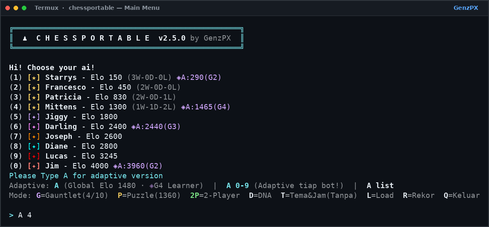
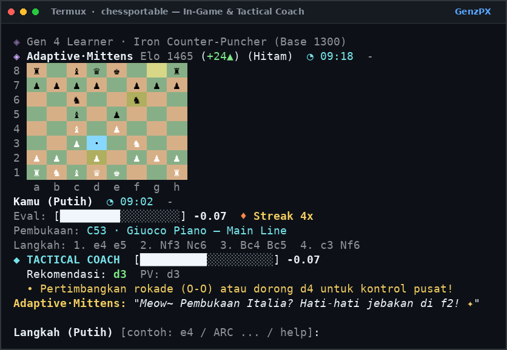
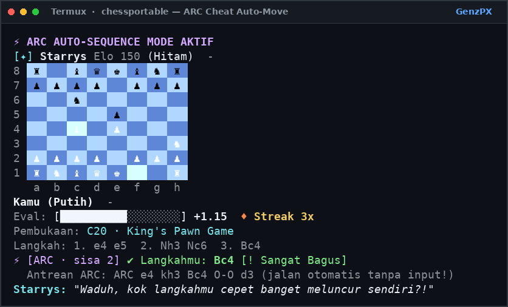
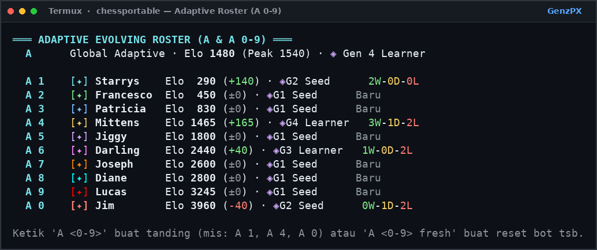
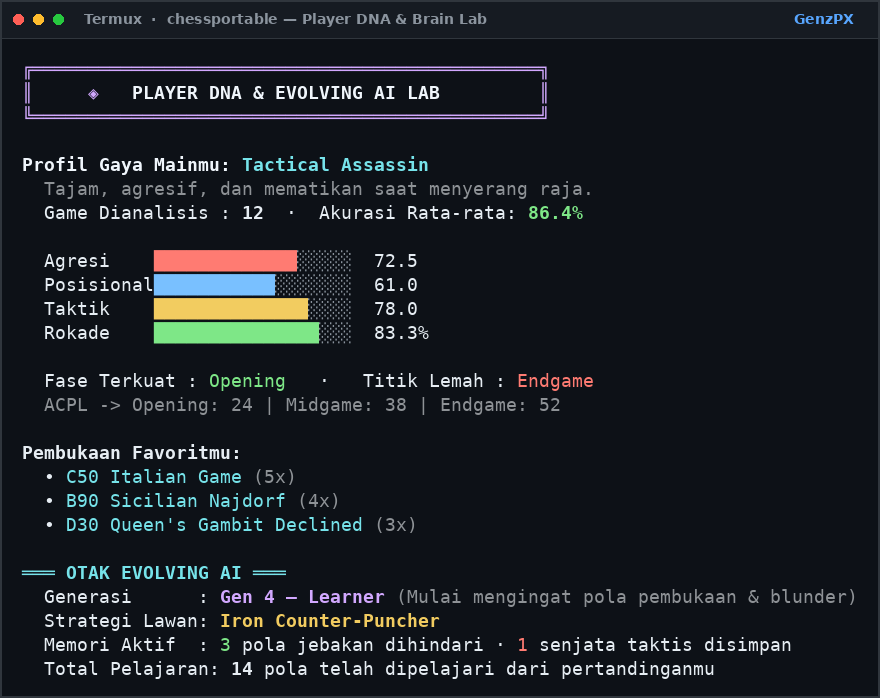
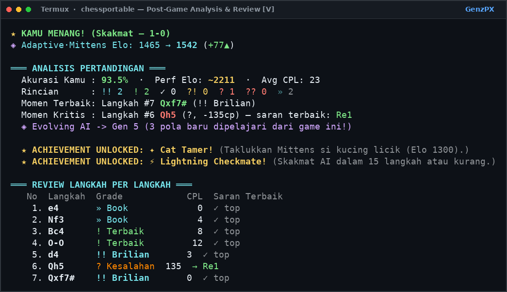

# ♟ ChessPortable v2.5 — by GenzPX

Game catur **Full CLI 100% Pure Python** buatan **GenzPX** untuk **Termux (Android)** & Linux/macOS — tanpa Stockfish, tanpa library eksternal, ringan, cepat, dengan **Per-Bot Adaptive Evolving (`A 0`–`A 9`)**, **ARC Auto-Sequence Cheat (`ARC ...`)**, **Live ECO Opening Detector (85+ pembukaan)**, **Tactical Coach + PV**, **Post-Game Review**, **Gauntlet Boss Rush**, **20 Tactical Puzzles**, **Mode 2-Player**, **6 Tema Warna 256-Color**, dan **Jam Catur**!


---

## 📦 Install di Termux (`pkg`)

### Cara 1: Langsung via Termux APT Repo (`pkg install chessportable`)
```bash
mkdir -p "$PREFIX/etc/apt/sources.list.d"
echo "deb [trusted=yes] https://genzpx.github.io/chessportable ./" > "$PREFIX/etc/apt/sources.list.d/chessportable.list"
pkg update
pkg install chessportable
chessportable
```

### Cara 2: Download `.deb` dari Releases
```bash
curl -LO https://github.com/GenzPx/chessportable/releases/download/v2.5.0/chessportable_2.5.0_all.deb
pkg install ./chessportable_2.5.0_all.deb
chessportable
```

### Cara 3: Clone & Install Lokal (Termux / Linux / macOS)
```bash
git clone https://github.com/GenzPx/chessportable.git
cd chessportable
./install.sh
chessportable
```

---

## 📸 Preview Layar Game

| Main Menu | In-Game + Tactical Coach | ARC Auto-Sequence Cheat |
|---|---|---|
|  |  |  |

| Adaptive Roster (`A 0-9`) | Player DNA Lab (`D`) | Post-Game Review (`[V]`) |
|---|---|---|
|  |  |  |

---

## ✨ Menu Utama

```text
Hi! Choose your ai!
(1) [✦] Starrys - Elo 150
(2) [✦] Francesco - Elo 450
(3) [✦] Patricia - Elo 830
(4) [✦] Mittens - Elo 1300
(5) [✦] Jiggy - Elo 1800
(6) [✦] Darling - Elo 2400
(7) [✦] Joseph - Elo 2600
(8) [✦] Diane - Elo 2800
(9) [✦] Lucas - Elo 3245
(0) [✦] Jim - Elo 4000
Please Type A for adaptive version
Adaptive: A (Global · Elo 1000) | A 0-9 (Adaptive tiap bot!) | A list
Mode: G=Gauntlet(0/10)  P=Puzzle(1000)  2P=2-Player  D=DNA  T=Tema&Jam  L=Load  R=Rekor  Q=Keluar
```

---

## 🚀 Fitur Utama v2.5

### ⚡ ARC Cheat / Auto-Sequence Mode (`ARC ...`)
Tulis `ARC` diikuti rangkaian langkahmu sekaligus — semua langkah akan langsung dijalankan **otomatis satu per satu tanpa perlu input lagi** di setiap giliranmu!
```text
ARC e4 kh3 Bc4 O-O d3
```
- Mendukung notasi SAN standar (`e4`, `Nf3`, `Bc4`, `O-O`, `e2e4`) sekaligus singkatan Kuda (`kh3` → `Nh3`).
- Jika salah satu langkah di tengah antrean terblokir atau jadi ilegal karena balasan lawan, `ARC` otomatis berhenti dengan aman dan mengembalikan kendali ke tanganmu.
- Bisa dipakai di mode lawan Bot maupun mode 2-Player (`2P`).

### 🧬 Per-Bot Adaptive (`A 0`–`A 9`) + Global Adaptive (`A`)
- **`A`** — Global Adaptive: mulai dari Elo adaptif terakhirmu dan berevolusi melintasi semua tier (Starrys → Jim).
- **`A 1` .. `A 9`, `A 0`** — **Per-Bot Adaptive**: pilih bot mana pun untuk punya versi Adaptive-nya sendiri (contoh: `A 1`, `A 4`, `A 7`, `A 0`). Setiap bot punya Elo adaptif, rekor rivalitas, dan memori lintas-game sendiri sambil mempertahankan karakter aslinya.
- **`A <0-9> fresh`** — Reset Elo & memori bot tertentu ke Base Elo & Gen 1 (contoh: `A 4 fresh`).
- **`A list`** — Lihat **Adaptive Roster** lengkap untuk Global + seluruh 10 bot.

### 📖 ECO Opening Detector, Tactical Coach & Post-Game Review
- **85+ Pembukaan ECO**: otomatis terdeteksi di bawah papan (misal `C53 · Giuoco Piano — Main Line`, `B90 · Sicilian Defense: Najdorf`, `D30 · Queen's Gambit Declined`) dan otomatis masuk ke header `[ECO]` / `[Opening]` saat ekspor `.PGN`.
- **`coach`**: deteksi bidakmu yang tidak terjaga, bidak lawan yang menggantung gratis, peringatan skak/rokade, dan rekomendasi langkah + **Principal Variation (`PV`)**.
- **Move Grading, Hot Streak (`Streak 3x`) & `[V] Review`**: penilaian langkah otomatis (`!!`, `!`, `✓`, `?!`, `?`, `??`, `Book`) dan tabel evaluasi langkah per langkah setelah pertandingan selesai.

### 🔥 Mode & Kustomisasi Tambahan
- **`G` Gauntlet Boss Rush**: lawan 10 bot beruntun (Starrys → Jim) dengan stage tersimpan.
- **`P` Tactical Puzzles**: 20 puzzle taktis terkurasi (Elo 600–2200) lengkap dengan Puzzle Rating & hint.
- **`2P` 2-Player Lokal**: main pass-and-play dengan auto-flip & jam catur.
- **`T` Tema & Jam**: 6 tema papan 256-color (`sage`, `wood`, `ocean`, `neon`, `crimson`, `mono`), toggle Unicode ↔ ASCII ↔ Plain, dan jam Bullet/Blitz/Rapid.
- **`R` Rekor & 12 Achievements** + Save/Load multi-slot + Ekspor `.PGN`.

---

## ⌨️ Command In-Game

| Command | Fungsi |
|---|---|
| `e4`, `E4`, `Nf3`, `Bxc6`, `O-O`, `e8=Q`, `e2e4` | Masukkan langkah (SAN atau koordinat; langkah tidak sah menampilkan `Illegal!`) |
| `ARC <m1> <m2> ...` | Jalankan rangkaian langkah otomatis tanpa input (misal: `ARC e4 kh3 Bc4`) |
| `coach` | Analisis posisi: deteksi bidak gantung, peluang gratis & PV terbaik |
| `hint` / `h` | Saran langkah terbaik + highlight papan + PV |
| `eval` / `eval on\|off` | Evaluasi posisi + PV / toggle eval bar |
| `moves [kotak]` | Daftar langkah legal + highlight kotak tujuan (misal: `moves g1`) |
| `undo` / `u` | Batalkan langkah terakhir |
| `style` / `theme [nama]` / `flip` | Ganti gaya bidak / ganti tema papan / putar papan |
| `dna` / `history` / `fen` | Lihat DNA & memori / riwayat langkah / FEN |
| `save [nama]` / `load [nama]` / `export [nama]` | Simpan / muat game / ekspor `.PGN` |
| `think <detik>` | Atur batas waktu berpikir bot (`think 1.5` / `think default`) |
| `draw` / `resign` / `menu` / `quit` | Remis / Menyerah / Menu / Keluar |

---

## 🛠️ CLI Flags

```bash
chessportable --bot 4             # Langsung lawan Mittens
chessportable --adaptive          # Langsung Global Adaptive
chessportable --adaptive 4        # Langsung Per-Bot Adaptive Mittens (A 4)
chessportable --adaptive 0        # Langsung Per-Bot Adaptive Jim (A 0)
chessportable --puzzles           # Langsung Tactical Puzzles
chessportable --gauntlet          # Langsung Gauntlet Boss Rush
chessportable --theme neon --ascii
chessportable --version
```

---

## 📄 Lisensi

MIT License — © 2026 **GenzPX**
