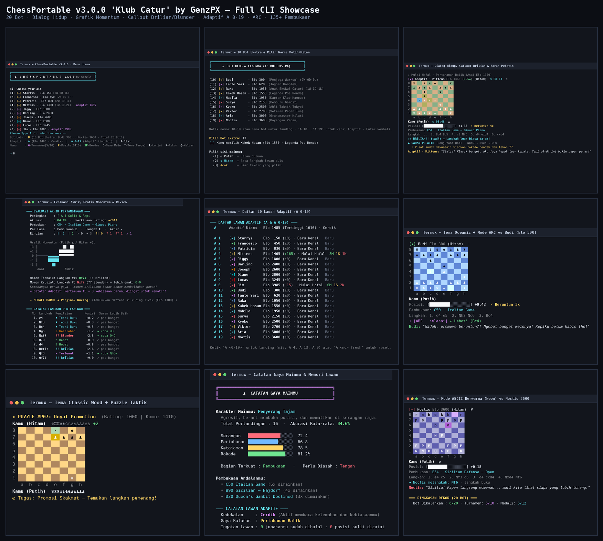
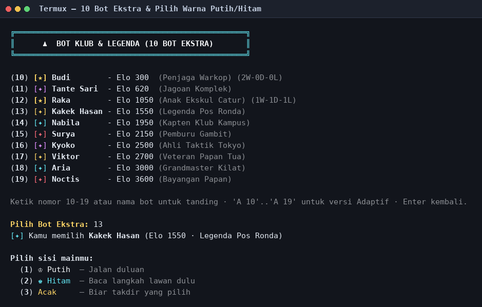
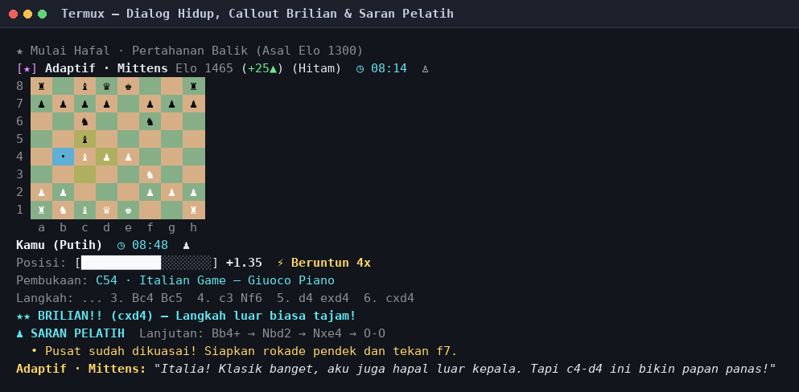
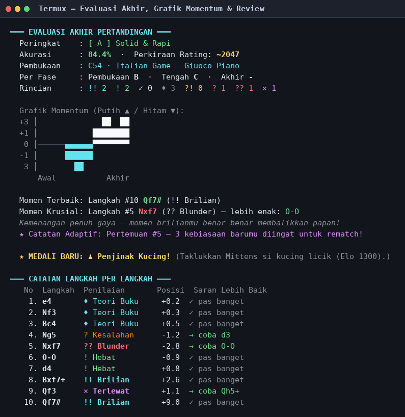
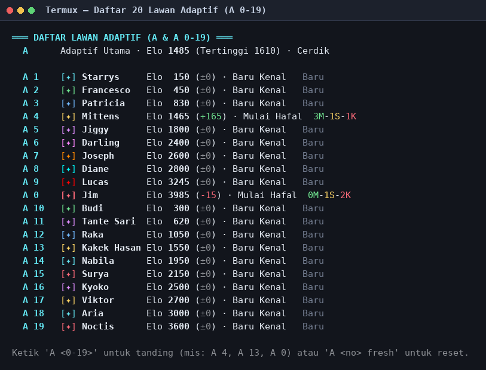
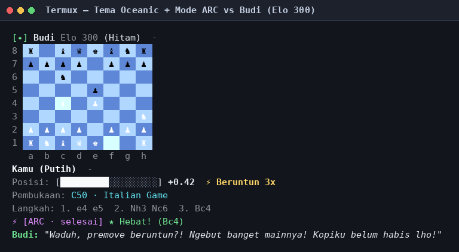
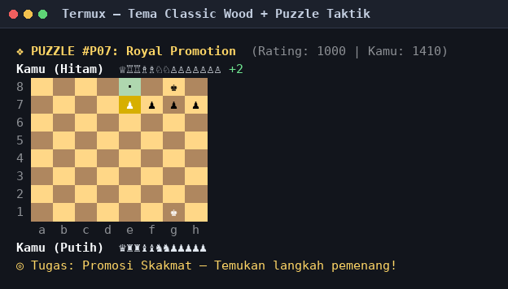
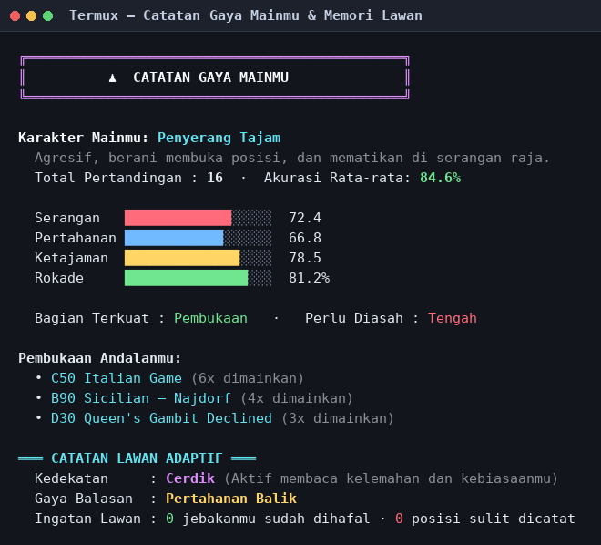

# ♟ ChessPortable v3.0.0 ("Klub Catur")

**Catur CLI 100% Pure-Python untuk Termux** oleh **GenzPX** — ringan, tanpa dependency eksternal, tanpa Stockfish, penuh karakter, dan terasa seperti nongkrong di klub catur sungguhan.



---

## ✨ Apa yang Baru di v3.0.0 ("Klub Catur")

- **20 Bot Berkarakter Unik (Elo 150 – 4000)**:
  - **10 Bot Klasik** tetap utuh di menu utama: `(1) Starrys 150` s/d `(9) Lucas 3245` & `(0) Jim 4000`.
  - **10 Bot Ekstra (`B`)**: `(10) Budi 300`, `(11) Tante Sari 620`, `(12) Raka 1050`, `(13) Kakek Hasan 1550`, `(14) Nabila 1950`, `(15) Surya 2150`, `(16) Kyoko 2500`, `(17) Viktor 2700`, `(18) Aria 3000`, `(19) Noctis 3600`.
- **Dialog Hidup & Peka Papan**:
  - Bot langsung bereaksi ke pembukaanmu (misal `1. e4` → *"e4 ya... Kau mau main apa?"*), 25+ nama pembukaan & jebakan (Italia, Sisilia, Ruy Lopez, Gambit Menteri, Fried Liver, Scholar's Mate, Bongcloud, dll.), bidak spesifik yang dimakan, rokade, en passant, promosi, skak, blunder, brilian, peluang terlewat, sampai mode `ARC`!
- **Notifikasi Langkah Ekspresif + Evaluasi Akhir Lengkap**:
  - Notif langsung tiap langkah: **`★★ BRILIAN!!`**, **`! Hebat`**, **`✓ Bagus`**, **`📖 Teori Buku`**, **`?! Kurang Pas`**, **`? Kesalahan`**, **`✕ Peluang Terlewat`**, **`✖ BLUNDER!!`**.
  - **Evaluasi Akhir Pertandingan** dengan **Peringkat (`S+` s/d `D`)**, **Nilai per Fase** (Pembukaan / Tengah / Akhir), **Grafik Momentum Pertandingan (Putih ▲ / Hitam ▼)**, momen terbaik & krusial, ringkasan cerita game, dan **`[V]` Catatan Langkah per Langkah**.
- **Pilih Warna Putih / Hitam / Acak yang Jelas** sebelum setiap pertandingan.
- **Mode Adaptif Untuk Semua 20 Bot (`A` & `A 0`–`A 19`)**:
  - Setiap bot punya rating & memori adaptif sendiri (`A 4`, `A 13`, `A 0`, `A list`, `A <no> fresh`).
- **135+ Detektor Pembukaan ECO** + **Saran Pelatih (`coach` / `saran`)** + **ARC Auto-Sequence (`ARC e4 kh3 Bc4 ...`)**.
- **Mode Tambahan**: Turnamen Beruntun 10 Bot (`G`), 20 Puzzle Taktik (`P`), 2-Player Lokal (`2P`), 6 Tema Warna Papan + Mode Unicode/ASCII (`T`), Jam Catur, Save/Load, dan Ekspor `.PGN`.

---

## 📱 Instalasi di Termux (via `pkg`)

### Cara 1 — Langsung dari Termux APT Repo (`pkg install`)

```bash
pkg update && pkg install -y curl
mkdir -p $PREFIX/etc/apt/sources.list.d
echo "deb [trusted=yes] https://genzpx.github.io/chessportable ./" > $PREFIX/etc/apt/sources.list.d/chessportable.list
pkg update
pkg install chessportable
```

Jalankan kapan saja:
```bash
chessportable
```

### Cara 2 — Install File `.deb` dari GitHub Releases

```bash
curl -LO https://github.com/GenzPx/chessportable/releases/download/v3.0.0/chessportable_3.0.0_all.deb
pkg install ./chessportable_3.0.0_all.deb
chessportable
```

### Cara 3 — Install dari Source (Linux / macOS / Termux)

```bash
git clone https://github.com/GenzPx/chessportable.git
cd chessportable
sh install.sh
chessportable
```

---

## 🖼️ Galeri Tampilan

| Menu Utama & 10 Bot Klasik | 10 Bot Ekstra (`B`) & Pilih Warna |
| :---: | :---: |
|  |  |

| Dialog Hidup, Callout & Saran Pelatih | Evaluasi Akhir, Grafik Momentum & Review |
| :---: | :---: |
|  |  |

| Daftar 20 Lawan Adaptif (`A 0-19`) | Mode ARC & Tema Oceanic |
| :---: | :---: |
|  |  |

| Puzzle Taktik & Tema Classic Wood | Catatan Gaya Mainmu |
| :---: | :---: |
|  |  |

---

## ♟️ Daftar 20 Bot

### 10 Bot Klasik (Menu Utama)
| Tombol | Nama | Elo | Karakter |
| :---: | :--- | :---: | :--- |
| `1` | **Starrys** | 150 | Pemula Santai |
| `2` | **Francesco** | 450 | Tukang Gebrak |
| `3` | **Patricia** | 830 | Penjaga Papan |
| `4` | **Mittens** | 1300 | Kucing Licik |
| `5` | **Jiggy** | 1800 | Ahli Serangan |
| `6` | **Darling** | 2400 | Master Elegan |
| `7` | **Joseph** | 2600 | Grandmaster Taktis |
| `8` | **Diane** | 2800 | Ratu Posisional |
| `9` | **Lucas** | 3245 | Pemburu Puncak |
| `0` | **Jim** | 4000 | Penantang Puncak |

### 10 Bot Ekstra (Ketik `B` atau langsung ketik `10`–`19`)
| Tombol | Nama | Elo | Julukan |
| :---: | :--- | :---: | :--- |
| `10` | **Budi** | 300 | Penjaga Warkop |
| `11` | **Tante Sari** | 620 | Jagoan Komplek |
| `12` | **Raka** | 1050 | Anak Ekskul Catur |
| `13` | **Kakek Hasan** | 1550 | Legenda Pos Ronda |
| `14` | **Nabila** | 1950 | Kapten Klub Kampus |
| `15` | **Surya** | 2150 | Pemburu Gambit |
| `16` | **Kyoko** | 2500 | Ahli Taktik Tokyo |
| `17` | **Viktor** | 2700 | Veteran Papan Tua |
| `18` | **Aria** | 3000 | Grandmaster Kilat |
| `19` | **Noctis** | 3600 | Bayangan Papan |

---

## 🎮 Perintah Penting di Dalam Permainan

- **Notasi / Koordinat**: `e4`, `E4`, `Nf3`, `Bxc6`, `O-O`, `e2e4`, `e8=Q`
- **`ARC <langkah...>`**: Jalan otomatis beruntun tanpa input (contoh: `ARC e4 kh3 Bc4 O-O`, otomatis berhenti jika ada langkah tidak sah)
- **`coach`** / **`saran`**: Saran pelatih + deteksi bidak yang tidak terjaga
- **`hint`** / **`moves e2`**: Saran langkah terbaik & sorot kotak sah di papan
- **`undo`** / **`flip`** / **`style`** / **`theme neon`**: Undo, putar papan, ganti Unicode ↔ ASCII, ganti tema
- **`save`** / **`load`** / **`export`**: Simpan permainan & ekspor `.PGN`
- **`gaya`** / **`history`** / **`draw`** / **`resign`**

---

## 🧪 Testing & Build Paket Termux

```bash
python3 -m unittest discover -s tests -v
sh termux-pkg/build_deb.sh
```

---

## 📄 Lisensi

MIT License — © 2026 **GenzPX**
